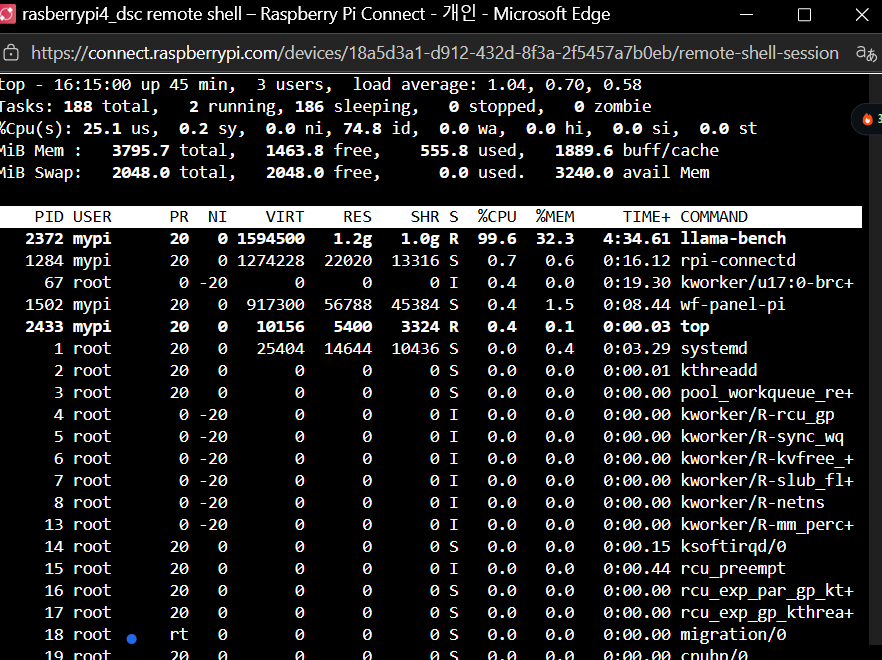
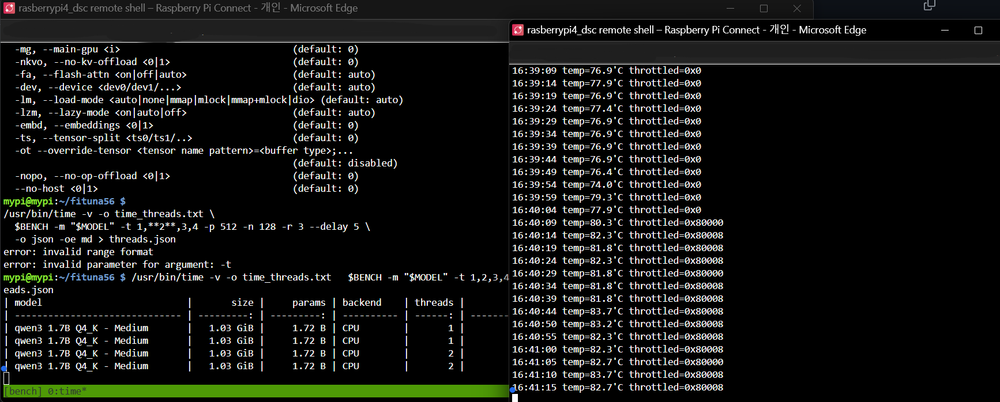
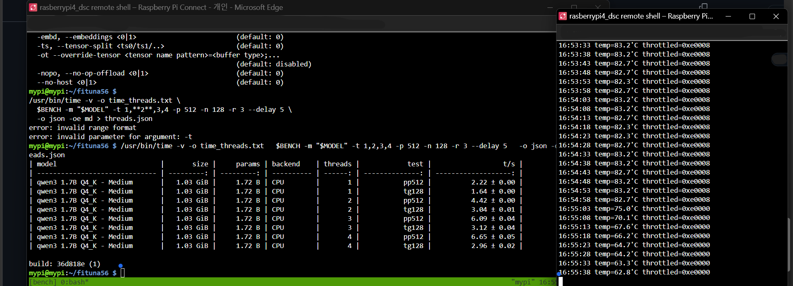
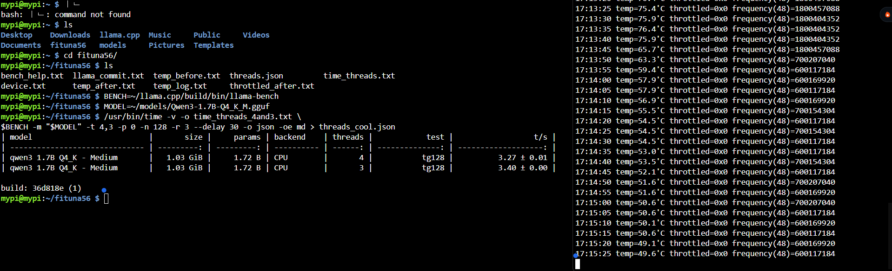

# docs: 라즈베리파이 4(4GB)에서 llama-bench 스레드 측정 결과 추가 (#56)

Refs #56

**변경 내용**

이슈 #56의 첫 단계("후보 파일 하나를 기기에 올리고 `llama-bench -t <여러 값> -o json` 결과를 올리기")를 Raspberry Pi 4에서 직접 측정한 결과를 추가합니다. 코드는 바꾸지 않았습니다.

```
docs/edge/rpi4-2026-11-26/
├── README.md                 # 이 PR 본문의 요약(환경·결과표·관찰)
├── device.txt                # 기기 정보 (모델, OS, 커널, RAM, 디스크, 온도, governor)
├── llama_commit.txt          # llama.cpp 커밋
├── bench_help.txt            # 이 빌드의 llama-bench --help (지원 옵션 확인용)
├── threads.json              # 본 측정: -t 1,2,3,4, pp512/tg128, -r 3, --delay 5
├── time_threads.txt          # 본 측정의 /usr/bin/time -v (peak RSS, 소요 시간)
├── temp_before.txt / temp_after.txt / throttled_after.txt
├── temp_log.txt              # 본 측정 중 5초 간격 온도·throttled 기록
├── threads_cool.json         # 재측정: 식힌 뒤 -t 4,3, tg128만, --delay 30
├── time_threads_4and3.txt
├── temp_before_4and3.txt
├── thermal_log_4and3.txt     # 재측정 중 온도·throttled·CPU 클럭 기록
└── images/                   # 측정 화면 캡처
```

**변경 이유**

#56은 엣지 기기에서 전체 탐색 없이 벤치마크만 돌리는 경로를 설계하기 위한 실측 데이터를 요청합니다. 이 PR은 그 근거로 쓸 수 있는 Pi 4 수치 하나를 제공합니다. 특히 아래 두 가지는 설계에 바로 영향을 줍니다.

1. **생성 속도(tg)는 코어 4개보다 3개일 때 더 빠릅니다.** 발열이 있을 때와 없을 때 모두 같은 결과입니다.
2. **방열 없이 연속 측정하면 약 30분 뒤 thermal throttling이 걸리고, 측정값이 약 8~10% 낮아집니다.** `--delay 5`로는 막지 못했습니다.

---

## 측정 환경

| 항목 | 값 |
|---|---|
| 기기 | Raspberry Pi 4 Model B Rev 1.5, RAM 4 GB(3.7 GiB 표시), 4코어 |
| OS | Debian GNU/Linux 13 (trixie), 64-bit(aarch64), kernel 6.18.50+rpt-rpi-v8 |
| CPU governor | ondemand |
| 냉각 | 방열판 있음, 냉각팬 없음 |
| 전원 | 3.1A (측정 중 저전압 비트는 한 번도 켜지지 않음) |
| 저장 장치 | microSD 29 GB (측정 전 여유 21 GB) |
| llama.cpp | commit `36d818e`(build 1), 기기에서 직접 빌드, GNU 14.2.0, CPU backend만 사용 |
| 모델 | `Qwen3-1.7B-Q4_K_M.gguf`(unsloth 사전 양자화), 1,101,457,408 B(1.03 GiB), 파라미터 1.72 B |
| 접속 | SSH + Raspberry Pi Connect 원격 셸, 측정은 tmux 안에서 실행 |

FiTuna로 만든 후보 대신 공개된 양자화 파일을 썼습니다. #56 첫 단계의 목적(기기에서 bench만 돌리기)에는 충분하다고 판단했습니다.

## 측정 1: 스레드 1~4 (본 측정)

```bash
/usr/bin/time -v -o time_threads.txt \
  llama-bench -m Qwen3-1.7B-Q4_K_M.gguf -t 1,2,3,4 -p 512 -n 128 -r 3 --delay 5 \
  -o json -oe md > threads.json
```

| threads | pp512 t/s | tg128 t/s | 측정 시작(KST) | 측정 중 throttling |
|---:|---:|---:|---|---|
| 1 | 2.22 ± 0.00 | 1.64 ± 0.00 | 16:10 / 16:25 | 없음 |
| 2 | 4.42 ± 0.00 | 3.04 ± 0.01 | 16:29 / 16:37 | 없음 |
| 3 | 6.09 ± 0.04 | 3.12 ± 0.04 | 16:39 / 16:45 | **있음** (16:40부터) |
| 4 | 6.65 ± 0.05 | 2.96 ± 0.02 | 16:47 / 16:52 | **있음** (최고 86.2°C) |

- 전체 소요 시간: **44분 39초**
- Peak RSS: **1,249 MB**(1,279,208 KB). 모델 파일 1,050 MiB + 약 200 MB
- 온도: 측정 전 45.2°C → 측정 직후 56.9°C(식는 중에 잼), 측정 중 최고 **86.2°C**
- `get_throttled` 변화(`temp_log.txt`)
  - 16:40:09 `0x80000` → 16:40:14부터 `0x80008`: soft temp limit(80°C)에 도달해 지금 제한 중
  - 16:43:25부터 `0xe0008`: 클럭 상한과 throttling도 발생
  - 16:48:21 이후 `0xe0006`이 여러 번 보임: **측정 중에 실제로 클럭이 깎이고 있음**
  - 저전압 비트(bit 0, 16)는 끝까지 0 → 전원 문제는 아님
- 측정이 끝난 뒤 `throttled_after.txt`: `0xe0000`

## 측정 2: 식힌 뒤 3·4스레드 재측정

측정 1에서 4스레드 tg가 3스레드보다 느리게 나왔는데, 이게 발열 탓인지 확인하려고 재부팅 후 식힌 상태(44.3°C)에서 tg만 다시 쟀습니다. 테스트 사이 간격은 30초로 늘렸습니다.

```bash
/usr/bin/time -v -o time_threads_4and3.txt \
  llama-bench -m Qwen3-1.7B-Q4_K_M.gguf -t 4,3 -p 0 -n 128 -r 3 --delay 30 \
  -o json -oe md > threads_cool.json
```

| threads | tg128 t/s (식힌 뒤) | tg128 t/s (측정 1, throttling 중) | 차이 |
|---:|---:|---:|---:|
| 4 | **3.27 ± 0.01** | 2.96 ± 0.02 | −9.5 % |
| 3 | **3.40 ± 0.00** | 3.12 ± 0.04 | −8.2 % |

- 전체 소요 시간 5분 17초, Peak RSS 1,145 MB(1,172,248 KB)
- 최고 76.4°C, `get_throttled`는 끝까지 `0x0`, 측정 중 ARM 클럭은 계속 1.8 GHz(`thermal_log_4and3.txt`)
- 테스트 사이 쉬는 동안에는 ondemand governor가 클럭을 600~700 MHz로 내렸다가 측정이 시작되면 1.8 GHz로 돌아옴

## 시험 실행 (참고)

`-t 4 -p 64 -n 16 -r 1`을 두 번 실행해 pp64 8.70 / 8.71 t/s, tg16 3.36 / 3.35 t/s를 얻었습니다. 짧은 측정이라 발열 영향이 거의 없습니다.

## 관찰

1. **tg에 가장 좋은 스레드 수는 4코어 중 3개입니다.** 식힌 상태에서도 3스레드(3.40)가 4스레드(3.27)보다 약 4 % 빠릅니다. 생성 단계는 메모리 대역폭에 묶여 있어서, 2스레드(3.04)부터는 코어를 늘려도 거의 빨라지지 않습니다. 기기용 bench 경로에서 스레드 기본값을 `nproc`로 고정하지 말고 `-t` 축을 탐색해야 한다는 #56의 제안을 뒷받침합니다.
2. **pp(프롬프트 처리)는 코어 수에 비례해서 빨라집니다.** 1→2→3→4스레드에서 2.22 → 4.42 → 6.09 → 6.65 t/s(1스레드 대비 2.0× / 2.7× / 3.0×)입니다. 3·4스레드는 throttling 중에 잰 값이라 실제로는 더 높을 수 있습니다(식힌 상태 pp는 재측정하지 않았습니다).
3. **방열이 없으면 결과가 측정 순서에 따라 달라집니다.** 스레드 1→4 순서로 돌리면 뒤쪽(3·4스레드)만 뜨거운 상태에서 측정돼서 불리해집니다. `--delay 5`로는 부족했습니다. Pi 4에서는 다음 중 하나가 필요해 보입니다.
   - 방열판·팬 사용
   - `--delay`를 30초 이상으로 늘리기
   - 측정 전후 `vcgencmd get_throttled`를 기록하고 `0x0`이 아니면 결과에 표시하기
4. **메모리는 4 GB Pi에서 여유가 있습니다.** 1.7B Q4_K_M의 peak RSS는 약 1.2 GB로, 전체 RAM의 약 1/3입니다(`top`에서도 RES 1.2 g, %MEM 32.3 확인). 같은 RAM에서 더 큰 모델(예: 4B Q4_K_M, 약 2.5 GB)도 올라갈 가능성이 있습니다.
5. **1스레드는 시간이 매우 오래 걸립니다.** 1스레드 pp512 한 번에 약 3분 50초가 걸려, 전체 44분 중 약 15분을 차지했습니다. 기기에서 스레드를 탐색할 때는 1스레드를 빼거나 pp 길이를 줄이는 편이 실용적입니다.

## 이번에 하지 않은 것

- 긴 컨텍스트 측정(`-d 1408`, MANUAL 7단계)은 시간이 부족해 하지 못했습니다.
- 식힌 상태의 pp512 재측정은 하지 않았습니다.
- FiTuna로 만든 후보 GGUF를 `scp`로 올려 재는 흐름은 해 보지 않았습니다.
- `--low-disk`(#92, PR #106) 기기 검증은 준비 단계에서 멈췄습니다. Pi의 venv에 `pip install -U fituna`로 **fituna 0.3.8 설치까지 확인**했고(piwheels에서 받음), `SmolLM2-135M-Instruct-f16.gguf`를 받던 중 측정 시간이 끝났습니다. 이 검증은 별도 작업으로 이어서 하겠습니다.

## 화면 캡처

<!-- 이미지는 GitHub 편집창에 끌어다 놓으면 링크가 생깁니다. URL 표시줄과 즐겨찾기 줄은 잘라 주세요. -->

1. 측정 1 중 `top`: llama-bench CPU 99.6 %(1스레드 구간), RES 1.2 g


2. 측정 1 중 + 같은 시각의 온도 로그(`0xe0008`, 83°C 안팎)


3. 측정 1 결과 표 + 온도 로그


4. 측정 2 결과 표


<details><summary>threads.json (측정 1 원본)</summary>

```json
[
  {
    "build_commit": "36d818e",
    "build_number": 1,
    "cpu_info": "CPU",
    "gpu_info": "",
    "backends": "CPU",
    "model_filename": "/home/mypi/models/Qwen3-1.7B-Q4_K_M.gguf",
    "model_type": "qwen3 1.7B Q4_K - Medium",
    "model_size": 1101457408,
    "model_n_params": 1720574976,
    "n_batch": 2048,
    "n_ubatch": 512,
    "n_threads": 1,
    "cpu_mask": "0x0",
    "cpu_strict": false,
    "poll": 50,
    "type_k": "f16",
    "type_v": "f16",
    "n_gpu_layers": -1,
    "n_cpu_moe": 0,
    "split_mode": "layer",
    "main_gpu": 0,
    "no_kv_offload": false,
    "flash_attn": -1,
    "devices": "auto",
    "tensor_split": "0.00",
    "tensor_buft_overrides": "none",
    "load_mode": "auto",
    "lazy_mode": "auto",
    "embeddings": false,
    "no_op_offload": 0,
    "no_host": false,
    "repack": true,
    "fit_target": 0,
    "fit_min_ctx": 0,
    "n_prompt": 512,
    "n_gen": 0,
    "n_depth": 0,
    "test_time": "2026-11-26T07:10:21Z",
    "avg_ns": 230616736844,
    "stddev_ns": 14019494,
    "avg_ts": 2.220134,
    "stddev_ts": 0.000135,
    "samples_ns": [ 230610291372, 230607099248, 230632819912 ],
    "samples_ts": [ 2.2202, 2.22023, 2.21998 ]
  },
  {
    "build_commit": "36d818e",
    "build_number": 1,
    "cpu_info": "CPU",
    "gpu_info": "",
    "backends": "CPU",
    "model_filename": "/home/mypi/models/Qwen3-1.7B-Q4_K_M.gguf",
    "model_type": "qwen3 1.7B Q4_K - Medium",
    "model_size": 1101457408,
    "model_n_params": 1720574976,
    "n_batch": 2048,
    "n_ubatch": 512,
    "n_threads": 1,
    "cpu_mask": "0x0",
    "cpu_strict": false,
    "poll": 50,
    "type_k": "f16",
    "type_v": "f16",
    "n_gpu_layers": -1,
    "n_cpu_moe": 0,
    "split_mode": "layer",
    "main_gpu": 0,
    "no_kv_offload": false,
    "flash_attn": -1,
    "devices": "auto",
    "tensor_split": "0.00",
    "tensor_buft_overrides": "none",
    "load_mode": "auto",
    "lazy_mode": "auto",
    "embeddings": false,
    "no_op_offload": 0,
    "no_host": false,
    "repack": true,
    "fit_target": 0,
    "fit_min_ctx": 0,
    "n_prompt": 0,
    "n_gen": 128,
    "n_depth": 0,
    "test_time": "2026-11-26T07:25:49Z",
    "avg_ns": 78012146138,
    "stddev_ns": 2032001,
    "avg_ts": 1.640770,
    "stddev_ts": 0.000043,
    "samples_ns": [ 78011381092, 78010607709, 78014449613 ],
    "samples_ts": [ 1.64079, 1.6408, 1.64072 ]
  },
  {
    "build_commit": "36d818e",
    "build_number": 1,
    "cpu_info": "CPU",
    "gpu_info": "",
    "backends": "CPU",
    "model_filename": "/home/mypi/models/Qwen3-1.7B-Q4_K_M.gguf",
    "model_type": "qwen3 1.7B Q4_K - Medium",
    "model_size": 1101457408,
    "model_n_params": 1720574976,
    "n_batch": 2048,
    "n_ubatch": 512,
    "n_threads": 2,
    "cpu_mask": "0x0",
    "cpu_strict": false,
    "poll": 50,
    "type_k": "f16",
    "type_v": "f16",
    "n_gpu_layers": -1,
    "n_cpu_moe": 0,
    "split_mode": "layer",
    "main_gpu": 0,
    "no_kv_offload": false,
    "flash_attn": -1,
    "devices": "auto",
    "tensor_split": "0.00",
    "tensor_buft_overrides": "none",
    "load_mode": "auto",
    "lazy_mode": "auto",
    "embeddings": false,
    "no_op_offload": 0,
    "no_host": false,
    "repack": true,
    "fit_target": 0,
    "fit_min_ctx": 0,
    "n_prompt": 512,
    "n_gen": 0,
    "n_depth": 0,
    "test_time": "2026-11-26T07:29:49Z",
    "avg_ns": 115829288627,
    "stddev_ns": 5909260,
    "avg_ts": 4.420298,
    "stddev_ts": 0.000226,
    "samples_ns": [ 115829864744, 115823112409, 115834888728 ],
    "samples_ts": [ 4.42028, 4.42053, 4.42008 ]
  },
  {
    "build_commit": "36d818e",
    "build_number": 1,
    "cpu_info": "CPU",
    "gpu_info": "",
    "backends": "CPU",
    "model_filename": "/home/mypi/models/Qwen3-1.7B-Q4_K_M.gguf",
    "model_type": "qwen3 1.7B Q4_K - Medium",
    "model_size": 1101457408,
    "model_n_params": 1720574976,
    "n_batch": 2048,
    "n_ubatch": 512,
    "n_threads": 2,
    "cpu_mask": "0x0",
    "cpu_strict": false,
    "poll": 50,
    "type_k": "f16",
    "type_v": "f16",
    "n_gpu_layers": -1,
    "n_cpu_moe": 0,
    "split_mode": "layer",
    "main_gpu": 0,
    "no_kv_offload": false,
    "flash_attn": -1,
    "devices": "auto",
    "tensor_split": "0.00",
    "tensor_buft_overrides": "none",
    "load_mode": "auto",
    "lazy_mode": "auto",
    "embeddings": false,
    "no_op_offload": 0,
    "no_host": false,
    "repack": true,
    "fit_target": 0,
    "fit_min_ctx": 0,
    "n_prompt": 0,
    "n_gen": 128,
    "n_depth": 0,
    "test_time": "2026-11-26T07:37:37Z",
    "avg_ns": 42080245100,
    "stddev_ns": 72053358,
    "avg_ts": 3.041813,
    "stddev_ts": 0.005213,
    "samples_ns": [ 41997173526, 42117788717, 42125773059 ],
    "samples_ts": [ 3.04782, 3.0391, 3.03852 ]
  },
  {
    "build_commit": "36d818e",
    "build_number": 1,
    "cpu_info": "CPU",
    "gpu_info": "",
    "backends": "CPU",
    "model_filename": "/home/mypi/models/Qwen3-1.7B-Q4_K_M.gguf",
    "model_type": "qwen3 1.7B Q4_K - Medium",
    "model_size": 1101457408,
    "model_n_params": 1720574976,
    "n_batch": 2048,
    "n_ubatch": 512,
    "n_threads": 3,
    "cpu_mask": "0x0",
    "cpu_strict": false,
    "poll": 50,
    "type_k": "f16",
    "type_v": "f16",
    "n_gpu_layers": -1,
    "n_cpu_moe": 0,
    "split_mode": "layer",
    "main_gpu": 0,
    "no_kv_offload": false,
    "flash_attn": -1,
    "devices": "auto",
    "tensor_split": "0.00",
    "tensor_buft_overrides": "none",
    "load_mode": "auto",
    "lazy_mode": "auto",
    "embeddings": false,
    "no_op_offload": 0,
    "no_host": false,
    "repack": true,
    "fit_target": 0,
    "fit_min_ctx": 0,
    "n_prompt": 512,
    "n_gen": 0,
    "n_depth": 0,
    "test_time": "2026-11-26T07:39:49Z",
    "avg_ns": 84123894360,
    "stddev_ns": 552889140,
    "avg_ts": 6.086437,
    "stddev_ts": 0.040067,
    "samples_ns": [ 83530617991, 84216317550, 84624747539 ],
    "samples_ts": [ 6.12949, 6.07958, 6.05024 ]
  },
  {
    "build_commit": "36d818e",
    "build_number": 1,
    "cpu_info": "CPU",
    "gpu_info": "",
    "backends": "CPU",
    "model_filename": "/home/mypi/models/Qwen3-1.7B-Q4_K_M.gguf",
    "model_type": "qwen3 1.7B Q4_K - Medium",
    "model_size": 1101457408,
    "model_n_params": 1720574976,
    "n_batch": 2048,
    "n_ubatch": 512,
    "n_threads": 3,
    "cpu_mask": "0x0",
    "cpu_strict": false,
    "poll": 50,
    "type_k": "f16",
    "type_v": "f16",
    "n_gpu_layers": -1,
    "n_cpu_moe": 0,
    "split_mode": "layer",
    "main_gpu": 0,
    "no_kv_offload": false,
    "flash_attn": -1,
    "devices": "auto",
    "tensor_split": "0.00",
    "tensor_buft_overrides": "none",
    "load_mode": "auto",
    "lazy_mode": "auto",
    "embeddings": false,
    "no_op_offload": 0,
    "no_host": false,
    "repack": true,
    "fit_target": 0,
    "fit_min_ctx": 0,
    "n_prompt": 0,
    "n_gen": 128,
    "n_depth": 0,
    "test_time": "2026-11-26T07:45:27Z",
    "avg_ns": 40981417003,
    "stddev_ns": 528466946,
    "avg_ts": 3.123715,
    "stddev_ts": 0.040539,
    "samples_ns": [ 40381591424, 41184199839, 41378459747 ],
    "samples_ts": [ 3.16976, 3.10799, 3.0934 ]
  },
  {
    "build_commit": "36d818e",
    "build_number": 1,
    "cpu_info": "CPU",
    "gpu_info": "",
    "backends": "CPU",
    "model_filename": "/home/mypi/models/Qwen3-1.7B-Q4_K_M.gguf",
    "model_type": "qwen3 1.7B Q4_K - Medium",
    "model_size": 1101457408,
    "model_n_params": 1720574976,
    "n_batch": 2048,
    "n_ubatch": 512,
    "n_threads": 4,
    "cpu_mask": "0x0",
    "cpu_strict": false,
    "poll": 50,
    "type_k": "f16",
    "type_v": "f16",
    "n_gpu_layers": -1,
    "n_cpu_moe": 0,
    "split_mode": "layer",
    "main_gpu": 0,
    "no_kv_offload": false,
    "flash_attn": -1,
    "devices": "auto",
    "tensor_split": "0.00",
    "tensor_buft_overrides": "none",
    "load_mode": "auto",
    "lazy_mode": "auto",
    "embeddings": false,
    "no_op_offload": 0,
    "no_host": false,
    "repack": true,
    "fit_target": 0,
    "fit_min_ctx": 0,
    "n_prompt": 512,
    "n_gen": 0,
    "n_depth": 0,
    "test_time": "2026-11-26T07:47:36Z",
    "avg_ns": 77016090632,
    "stddev_ns": 590312351,
    "avg_ts": 6.648223,
    "stddev_ts": 0.051181,
    "samples_ns": [ 76335220559, 77328585911, 77384465426 ],
    "samples_ts": [ 6.70726, 6.6211, 6.61632 ]
  },
  {
    "build_commit": "36d818e",
    "build_number": 1,
    "cpu_info": "CPU",
    "gpu_info": "",
    "backends": "CPU",
    "model_filename": "/home/mypi/models/Qwen3-1.7B-Q4_K_M.gguf",
    "model_type": "qwen3 1.7B Q4_K - Medium",
    "model_size": 1101457408,
    "model_n_params": 1720574976,
    "n_batch": 2048,
    "n_ubatch": 512,
    "n_threads": 4,
    "cpu_mask": "0x0",
    "cpu_strict": false,
    "poll": 50,
    "type_k": "f16",
    "type_v": "f16",
    "n_gpu_layers": -1,
    "n_cpu_moe": 0,
    "split_mode": "layer",
    "main_gpu": 0,
    "no_kv_offload": false,
    "flash_attn": -1,
    "devices": "auto",
    "tensor_split": "0.00",
    "tensor_buft_overrides": "none",
    "load_mode": "auto",
    "lazy_mode": "auto",
    "embeddings": false,
    "no_op_offload": 0,
    "no_host": false,
    "repack": true,
    "fit_target": 0,
    "fit_min_ctx": 0,
    "n_prompt": 0,
    "n_gen": 128,
    "n_depth": 0,
    "test_time": "2026-11-26T07:52:45Z",
    "avg_ns": 43178437278,
    "stddev_ns": 271757406,
    "avg_ts": 2.964521,
    "stddev_ts": 0.018721,
    "samples_ns": [ 42867395856, 43369902579, 43298013399 ],
    "samples_ts": [ 2.98595, 2.95136, 2.95626 ]
  }
]

```

</details>

<details><summary>threads_cool.json (측정 2 원본)</summary>

```json
[
  {
    "build_commit": "36d818e",
    "build_number": 1,
    "cpu_info": "CPU",
    "gpu_info": "",
    "backends": "CPU",
    "model_filename": "/home/mypi/models/Qwen3-1.7B-Q4_K_M.gguf",
    "model_type": "qwen3 1.7B Q4_K - Medium",
    "model_size": 1101457408,
    "model_n_params": 1720574976,
    "n_batch": 2048,
    "n_ubatch": 512,
    "n_threads": 4,
    "cpu_mask": "0x0",
    "cpu_strict": false,
    "poll": 50,
    "type_k": "f16",
    "type_v": "f16",
    "n_gpu_layers": -1,
    "n_cpu_moe": 0,
    "split_mode": "layer",
    "main_gpu": 0,
    "no_kv_offload": false,
    "flash_attn": -1,
    "devices": "auto",
    "tensor_split": "0.00",
    "tensor_buft_overrides": "none",
    "load_mode": "auto",
    "lazy_mode": "auto",
    "embeddings": false,
    "no_op_offload": 0,
    "no_host": false,
    "repack": true,
    "fit_target": 0,
    "fit_min_ctx": 0,
    "n_prompt": 0,
    "n_gen": 128,
    "n_depth": 0,
    "test_time": "2026-11-26T08:08:49Z",
    "avg_ns": 39148698271,
    "stddev_ns": 124025521,
    "avg_ts": 3.269607,
    "stddev_ts": 0.010361,
    "samples_ns": [ 39021508272, 39155290818, 39269295725 ],
    "samples_ts": [ 3.28024, 3.26903, 3.25954 ]
  },
  {
    "build_commit": "36d818e",
    "build_number": 1,
    "cpu_info": "CPU",
    "gpu_info": "",
    "backends": "CPU",
    "model_filename": "/home/mypi/models/Qwen3-1.7B-Q4_K_M.gguf",
    "model_type": "qwen3 1.7B Q4_K - Medium",
    "model_size": 1101457408,
    "model_n_params": 1720574976,
    "n_batch": 2048,
    "n_ubatch": 512,
    "n_threads": 3,
    "cpu_mask": "0x0",
    "cpu_strict": false,
    "poll": 50,
    "type_k": "f16",
    "type_v": "f16",
    "n_gpu_layers": -1,
    "n_cpu_moe": 0,
    "split_mode": "layer",
    "main_gpu": 0,
    "no_kv_offload": false,
    "flash_attn": -1,
    "devices": "auto",
    "tensor_split": "0.00",
    "tensor_buft_overrides": "none",
    "load_mode": "auto",
    "lazy_mode": "auto",
    "embeddings": false,
    "no_op_offload": 0,
    "no_host": false,
    "repack": true,
    "fit_target": 0,
    "fit_min_ctx": 0,
    "n_prompt": 0,
    "n_gen": 128,
    "n_depth": 0,
    "test_time": "2026-11-26T08:11:16Z",
    "avg_ns": 37641489127,
    "stddev_ns": 24550035,
    "avg_ts": 3.400504,
    "stddev_ts": 0.002219,
    "samples_ns": [ 37652199527, 37658864297, 37613403557 ],
    "samples_ts": [ 3.39954, 3.39893, 3.40304 ]
  }
]

```

</details>

**확인 목록**

- [ ] `pytest -q` 통과 — 해당 없음(문서와 측정 데이터만 추가)
- [ ] 변경한 module의 self-check 통과 — 해당 없음
- [ ] Contract 변경 시 `fituna/config.py`와 모든 사용처를 함께 수정 — 해당 없음
- [x] 새 runtime 의존성 없음
