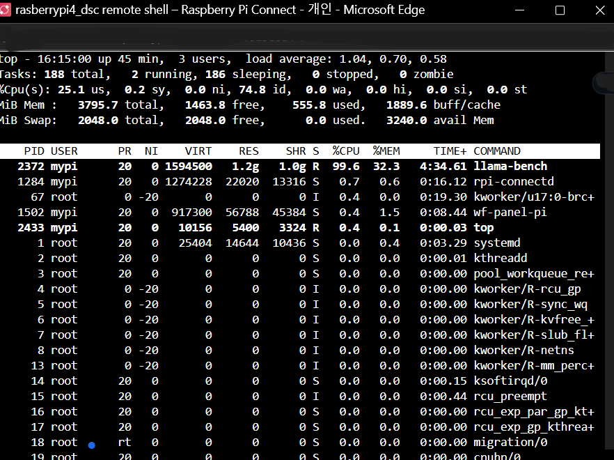
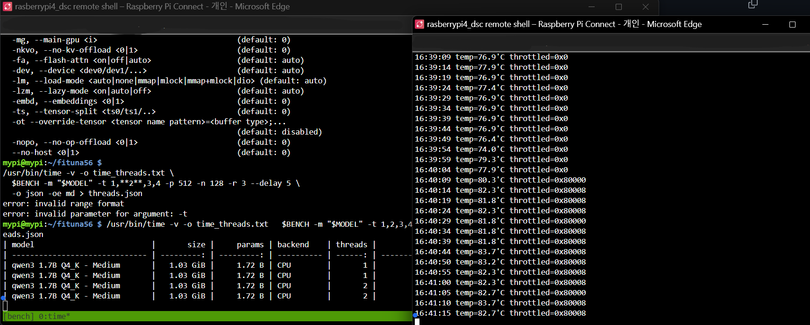
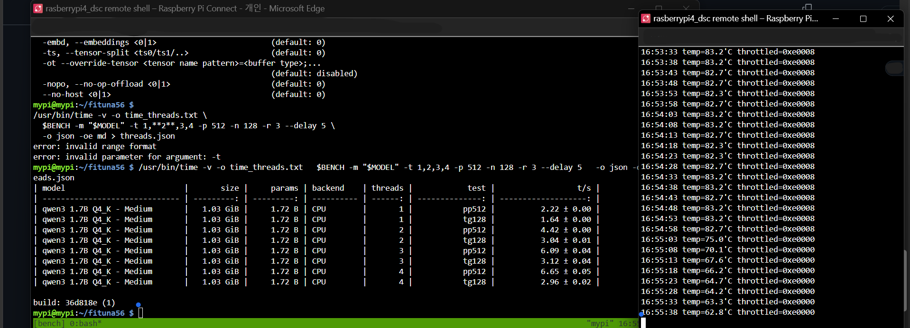
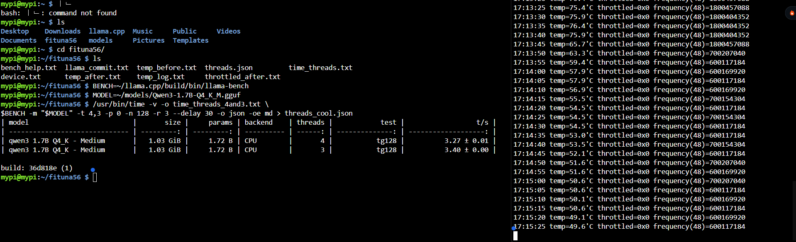

# Raspberry Pi 4(4GB) llama-bench 스레드 측정

관련 이슈: [#56](https://github.com/leeyunseokarchive/fituna/issues/56) (엣지 기기에서 전체 탐색 없이 벤치마크만 실행)

## 3줄 요약

- Raspberry Pi 4(4GB, 방열판 없음, 팬 없음)에서 Qwen3-1.7B Q4_K_M을 llama-bench로 스레드 1~4개씩 측정했습니다(llama.cpp `36d818e`, CPU 전용).
- 생성 속도(tg128)는 4스레드(3.27 t/s)보다 3스레드(3.40 t/s)가 빨랐고, 프롬프트 처리 속도(pp512)는 스레드를 늘릴수록 빨라져 4스레드에서 6.65 t/s였습니다. 최대 메모리 사용량은 약 1.25 GB입니다.
- 팬 없이 연속으로 측정하면 약 30분 뒤 80°C를 넘으면서 thermal throttling이 걸렸고, 이 때문에 측정값이 8~10% 낮아졌습니다. `--delay 5`로는 막지 못했습니다.

## 측정 환경

| 항목 | 값 |
|---|---|
| 기기 | Raspberry Pi 4 Model B Rev 1.5, RAM 4 GB(3.7 GiB 표시), 4코어 |
| OS | Debian GNU/Linux 13 (trixie), 64-bit(aarch64), kernel 6.18.50+rpt-rpi-v8 |
| CPU governor | ondemand |
| 냉각 | 없음(방열판, 냉각팬 모두 없음) |
| 전원 | 3.1A 어댑터 (측정 중 저전압 비트는 한 번도 켜지지 않음) |
| 저장 장치 | microSD 29 GB (측정 전 여유 21 GB) |
| llama.cpp | commit `36d818e`(build 1), 기기에서 직접 빌드, GNU 14.2.0, CPU backend만 사용 |
| 모델 | `Qwen3-1.7B-Q4_K_M.gguf`(unsloth 사전 양자화), 1,101,457,408 B(1.03 GiB), 파라미터 1.72 B |
| 측정일 | 2026-11-26 |

FiTuna로 만든 후보 대신 공개된 양자화 파일을 썼습니다. #56 첫 단계의 목적(기기에서 bench만 돌리기)에는 충분하다고 판단했습니다.

## 측정 1: 스레드 1~4

```bash
/usr/bin/time -v -o time_threads.txt \
  llama-bench -m Qwen3-1.7B-Q4_K_M.gguf -t 1,2,3,4 -p 512 -n 128 -r 3 --delay 5 \
  -o json -oe md > threads.json
```

| threads | pp512 t/s | tg128 t/s | 측정 시작(KST, pp / tg) | 측정 중 throttling |
|---:|---:|---:|---|---|
| 1 | 2.22 ± 0.00 | 1.64 ± 0.00 | 16:10 / 16:25 | 없음 |
| 2 | 4.42 ± 0.00 | 3.04 ± 0.01 | 16:29 / 16:37 | 없음 |
| 3 | 6.09 ± 0.04 | 3.12 ± 0.04 | 16:39 / 16:45 | **있음** (16:40부터) |
| 4 | 6.65 ± 0.05 | 2.96 ± 0.02 | 16:47 / 16:52 | **있음** (최고 86.2°C) |

- 전체 소요 시간: **44분 39초**
- Peak RSS: **1,249 MB**(1,279,208 KB). 모델 파일 1,050 MiB + 약 200 MB
- 온도: 측정 전 45.2°C, 측정 중 최고 **86.2°C**, 측정 직후 56.9°C(식는 중에 잼)
- `get_throttled` 변화(`temp_log.txt`)
  - 16:40:09 `0x80000` → 16:40:14부터 `0x80008`: soft temp limit(80°C)에 도달해 제한 중
  - 16:43:25부터 `0xe0008`: 클럭 상한과 throttling도 발생
  - 16:48:21 이후 `0xe0006`이 여러 번 보임: 측정 중에 실제로 클럭이 깎이고 있음
  - 저전압 비트(bit 0, 16)는 끝까지 0 → 전원 문제는 아님

## 측정 2: 식힌 뒤 3, 4스레드 재측정

측정 1에서 4스레드 tg가 3스레드보다 느리게 나와서, 발열 탓인지 확인하려고 재부팅 후 식힌 상태(44.3°C)에서 tg만 다시 쟀습니다. 테스트 사이 간격은 30초로 늘렸습니다.

```bash
/usr/bin/time -v -o time_threads_4and3.txt \
  llama-bench -m Qwen3-1.7B-Q4_K_M.gguf -t 4,3 -p 0 -n 128 -r 3 --delay 30 \
  -o json -oe md > threads_cool.json
```

| threads | tg128 t/s (식힌 뒤) | tg128 t/s (측정 1, throttling 중) | 차이 |
|---:|---:|---:|---:|
| 4 | **3.27 ± 0.01** | 2.96 ± 0.02 | −9.5 % |
| 3 | **3.40 ± 0.00** | 3.12 ± 0.04 | −8.2 % |

- 전체 소요 시간 5분 17초, Peak RSS 1,145 MB(1,172,248 KB)
- 최고 76.4°C, `get_throttled`는 끝까지 `0x0`, 측정 중 ARM 클럭은 계속 1.8 GHz(`thermal_log_4and3.txt`)

## 관찰

1. **tg에 가장 좋은 스레드 수는 4코어 중 3개입니다.** 식힌 상태에서도 3스레드(3.40)가 4스레드(3.27)보다 약 4 % 빠릅니다. 생성 단계는 메모리 대역폭에 묶여 있어서 2스레드(3.04)부터는 코어를 늘려도 거의 빨라지지 않습니다. 기기에서는 스레드 수를 `nproc`로 고정하지 말고 `-t`를 탐색하는 편이 좋습니다.
2. **pp는 코어 수에 비례해서 빨라집니다.** 1→2→3→4스레드에서 2.22 → 4.42 → 6.09 → 6.65 t/s(1스레드 대비 2.0× / 2.7× / 3.0×)입니다. 3, 4스레드는 throttling 중에 잰 값이라 실제로는 더 높을 수 있습니다.
3. **팬이 없으면 결과가 측정 순서에 따라 달라집니다.** 스레드 1→4 순서로 돌리면 뒤쪽(3, 4스레드)만 뜨거운 상태에서 측정돼 불리해집니다. `--delay 5`로는 부족했습니다. Pi 4에서는 다음 중 하나가 필요해 보입니다.
   - 냉각팬 사용
   - `--delay`를 30초 이상으로 늘리기
   - 측정 전후 `vcgencmd get_throttled`를 기록하고, `0x0`이 아니면 결과에 표시하기
4. **4 GB Pi에서 메모리는 여유가 있습니다.** 1.7B Q4_K_M의 peak RSS는 약 1.2 GB로 전체 RAM의 약 1/3입니다. 더 큰 모델(예: 4B Q4_K_M, 약 2.5 GB)도 올라갈 가능성이 있습니다.
5. **1스레드는 시간이 매우 오래 걸립니다.** 1스레드 pp512 한 번에 약 3분 50초가 걸려 전체 44분 중 약 15분을 차지했습니다. 기기에서 스레드를 탐색할 때는 1스레드를 빼거나 pp 길이를 줄이는 편이 실용적입니다.

## 하지 못한 것

- 긴 컨텍스트 측정(`-d 1408`)
- 식힌 상태의 pp512 재측정
- FiTuna로 만든 후보 GGUF를 기기로 옮겨 재는 흐름
- `--low-disk`(#92) 기기 검증: Pi에 fituna 0.3.8 설치까지 확인하고 중단

## 파일

| 파일 | 내용 |
|---|---|
| `device.txt` | 기기 정보 (모델, OS, 커널, RAM, 디스크, 온도, governor) |
| `llama_commit.txt` | llama.cpp 커밋 |
| `bench_help.txt` | 이 빌드의 `llama-bench --help` |
| `threads.json` | 측정 1 원본 결과 |
| `time_threads.txt` | 측정 1의 `/usr/bin/time -v` 출력 (peak RSS, 소요 시간) |
| `temp_before.txt`, `temp_after.txt`, `throttled_after.txt` | 측정 1 전후 온도와 throttled 값 |
| `temp_log.txt` | 측정 1 중 5초 간격 온도, throttled 기록 |
| `threads_cool.json` | 측정 2 원본 결과 |
| `time_threads_4and3.txt` | 측정 2의 `/usr/bin/time -v` 출력 |
| `temp_before_4and3.txt` | 측정 2 시작 전 온도 |
| `thermal_log_4and3.txt` | 측정 2 중 온도, throttled, CPU 클럭 기록 |

## 화면 캡처

측정 1 중 `top`: llama-bench CPU 99.6 %(1스레드 구간), RES 1.2 g



측정 1 중 온도 로그: 80°C를 넘으며 throttled 값이 바뀜



측정 1 결과 표 + 온도 로그 (약 45분 걸림)



측정 2 결과 표


